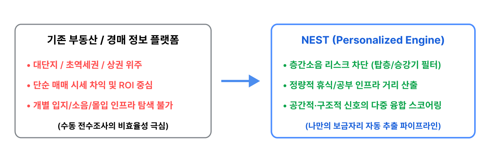
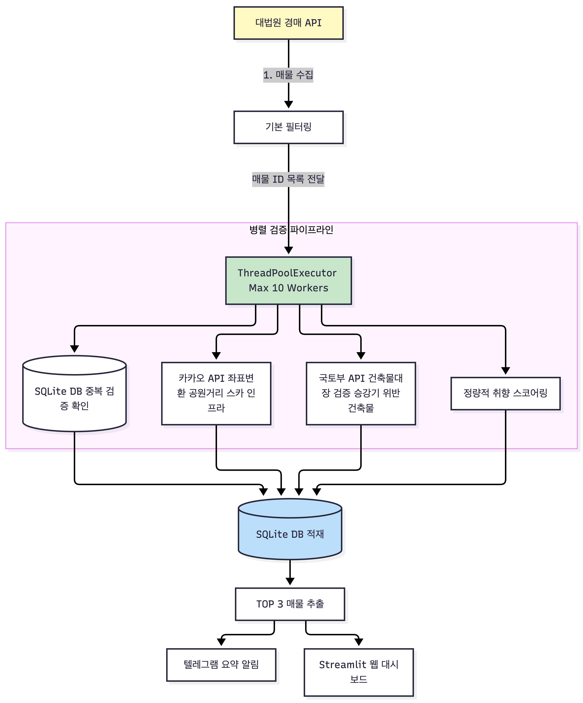

> **"From pain to cures (통증에서 치유와 해결책으로)"** <br />
> *모든 진정성 있는 엔지니어링은 삶에서 맞닥뜨린 문제를 해결하려는 열망에서 시작됩니다.*<br /> 이 글은 ‘밤마다 찾아오는 층간소음’이라는 일상의 고통에서 출발한 개발 기록입니다.

---

## 1. 개발 배경 및 문제 정의: 고통에서 시작된 보금자리 탐색

### 1.1. 불면의 밤, 조용한 몰입 공간에 대한 절박함
교대근무자가 거주하던 윗집의 한밤 중 불규칙한 발망치와 진동 소음은 일상의 리듬을 무너뜨렸습니다. 제게 '집'이란, 하루동안 누적된 자극을 비워내고 깊은 휴식을 취하는 공간이어야 했기에, 지속되는 수면 장애는 건강과 생산성을 위협하는 한계 상황이었습니다.

당장 서울에서 소음 걱정이 없는 내 집을 마련하기에는 자본의 제약이 컸습니다. 이에 한정된 예산 내에서 시세 대비 10~20%가량 저렴하게 실거주 매물을 매입할 수 있는 법원 경매시장으로 눈을 돌렸습니다.

### 1.2. 보편적 시장 가치 vs. 개인화된 라이프스타일 취향
기존 부동산 플랫폼은 '투자 수익률(ROI, Return on Investment)', '초역세권', ‘대단지 시세차익’ 같은 대중적 지표만 제공했습니다. 그러나 제가 절실히 원한 집의 조건은 명확했습니다:

* **층간소음 차단:** 상부층 소음원이 없는 탑층(Top Floor) 및 탑층 생활의 편의를 위한 승강기(Elevator) 설치 선호
* **몰입을 위한 주변 인프라:** 상가보다는 주택가, 반경 500m 이내 공원, 도서관/공유오피스/스터디카페 밀집 지역
* **리스크 배제:** 유흥가 야간 소음 구역, 위반건축물 및 과도한 유찰 매물 제외

수백-수천 개의 경매 매물을 매일 일일이 대법원 사이트와 지도 앱에서 대조하는 것은 한계가 있기에, 복합 데이터 소스(대법원 경매 + 카카오 공간정보 + 국토부 건축물대장)를 종합해서 위의 조건에 맞는 매물들을 스크리닝해주는 **NEST (Niche Estate Screening Tool)** 를 설계했습니다.

> 즉, NEST는, 새가 아무 곳에나 둥지를 짓지 않듯, 제게는 **내가 진정으로 머물고 싶은 나만의 보금자리(Nest)** 를 정밀하게 스크리닝해 주는 자동화 파이프라인입니다.*



---

## 2. 시스템 아키텍처 및 기술적 트레이드오프

> **"수백, 수천 개의 경매 매물을 수분 만에 분석하기: 다중 API 오케스트레이션과 동시성 최적화"**

서울 전역에 쏟아지는 방대한 법원 경매 풀에서, 내 주거 취향에 맞는 매물을 실시간으로 발굴하기 위해, 적용한 주요 기술적 방법들을 정리했습니다. 

### 2.1. 시스템 아키텍처
NEST는 3개의 외부 API와 연동되어 데이터를 수집하고, 정제 과정을 거쳐 SQLite에 저장하는 멀티스레드 파이프라인으로 동작합니다.



### 2.2. 정량적 선호도 스코어링 공식 (100점 만점)
사람마다 '좋은 집'의 기준은 다릅니다. 저의 경우 앞서 1.2에서 언급한, 치유와 몰입을 위한 기준들을 다음과 같이 수식화 하였습니다. 

$$
\text{Final Score} = \text{Base Score}(50) + S_{\text{park}} + S_{\text{study}} + S_{\text{elevator}} + S_{\text{top\_floor}}
$$

* **기본 점수 (50점):** 1차 필터링 통과 시 부여 (위반건축물 여부, 주변 유흥없소 없음 등)
* **공원 인접성 ($S_{\text{park}}$):** 반경 500m 이내 공원 거리에 비례하여 최대 20점 부여
* **인프라($S_{\text{study}}$):** 반경 1km 이내 스터디카페 또는 공유오피스 존재 시 개당 2점 (최대 15점)
* **가산점($S_{\text{elevator}}, S_{\text{top\_floor}}$):** 승강기 및 탑층 조건 충족 시 각각 +5점

### 2.3. 4가지 핵심 토이 코드 구현

#### ① 대법원 세션 동기화
대법원 경매 검색 서버는 검색 API를 직접 호출하면 빈 결과를 반환합니다. 따라서 올바른 헤더를 포함한 POST 요청을 보내, 세션 내에 특정 법원 코드를 먼저 등록하는 과정(Session Sync API Call)이 필수적입니다.

이는 은행 창구에서 번호표를 뽑고 신분증(헤더)과 신청서(POST)를 내서 접수(세션 등록)를 마쳐야만, 비로소 민감한 금융 정보를 조회할 수 있는 것과 같은 원리입니다.

```python
import requests


def sync_court_session(session: requests.Session, court_code: str):
    url = "https://www.courtauction.go.kr/pgj/pgjsearch/selectCortOfcDeptLst.on"
    headers = {
        "Content-Type": "application/json;charset=UTF-8",
        "Referer": "https://www.courtauction.go.kr/pgj/index.on",
    }
    try:
        session.post(
            url,
            json={"dma_srchGdsDtlSrchInfo": {"cortOfcCd": court_code}},
            headers=headers,
            timeout=5,
        )
    except Exception as e:
        print(f"Session Sync Warning: {e}")
```

#### ② 카카오 및 국토부 API 오케스트레이션
주소를 정제하고 표준화한 뒤, 카카오 API로 입지를 분석하고 국토부 건축물대장 오픈 API를 조회하여 위반건축물 여부와 승강기 유무를 검증합니다.

```python
import requests
import re


def verify_property(address: str, kakao_key: str):
    clean_addr = re.sub(r".*?구|해당층.*|\d+동|\d+호", "", address).strip()
    headers = {"Authorization": f"KakaoAK {kakao_key}"}

    res = requests.get(
        "https://dapi.kakao.com/v2/local/search/address.json",
        headers=headers,
        params={"query": clean_addr},
        timeout=3,
    ).json()
    if not res.get("documents"):
        return None

    doc = res["documents"][0]
    park_res = requests.get(
        "https://dapi.kakao.com/v2/local/search/keyword.json",
        headers=headers,
        params={"query": "공원", "x": doc["x"], "y": doc["y"], "radius": 500},
        timeout=3,
    ).json()
    min_park_dist = (
        min([float(p["distance"]) for p in park_res.get("documents", [])])
        if park_res.get("documents")
        else 999.0
    )

    return {"min_park_dist": min_park_dist, "has_elevator": True, "is_violation": False}
```

#### ③ SQLite를 활용한 멱등성 관리
매번 실행할 때마다 외부 API를 호출해 동일한 경매 물건을 재평가하는 것은 시스템 부하를 가중시키고 API 호출 제한(Rate Limit)을 유발합니다. SQLite DB를 활용하여 멱등성(Idempotency, 연산의 실행 횟수와 무관하게 결과가 동일함)을 보장합니다.

```python
import sqlite3


def is_already_processed(auction_id: str) -> bool:
    conn = sqlite3.connect("nest_vault.db", timeout=30)
    cursor = conn.cursor()
    cursor.execute(
        "CREATE TABLE IF NOT EXISTS processed_auctions (id TEXT PRIMARY KEY, score REAL)"
    )
    cursor.execute("SELECT 1 FROM processed_auctions WHERE id = ?", (auction_id,))
    exists = cursor.fetchone() is not None
    conn.close()
    return exists
```

#### ④ ThreadPoolExecutor를 통한 10배 동시성 향상
순차 처리(Sequential) 방식에서는 매물 분석에 10~15분의 I/O 병목(네트워크 송수신 지연)이 발생했습니다. 네트워크 대기 시간 동안 CPU가 다른 요청을 처리할 수 있도록, `ThreadPoolExecutor(max_workers=10)`을 적용한 멀티스레드 동시성 처리를 통해, 전체 분석 시간을 약 1분 내외로 10배이상 단축시켰습니다.

```python
from concurrent.futures import ThreadPoolExecutor


def process_single(prop: dict):
    if is_already_processed(prop["id"]):
        return None
    return {"id": prop["id"], "score": 85.5}


def evaluate_auctions_fast(raw_properties: list, max_workers: int = 10):
    with ThreadPoolExecutor(max_workers=max_workers) as executor:
        results = list(executor.map(process_single, raw_properties))
    return sorted([r for r in results if r], key=lambda x: x["score"], reverse=True)
```

### 2.4. 기술적 트레이드오프 (Technical Trade-offs)

* **Multiprocessing vs. ThreadPoolExecutor**
  * **결정:** `ThreadPoolExecutor` 채택
  * **이유:** 성능 병목이 CPU 연산 복잡도가 아닌 외부 REST API 응답 대기 시간(I/O Bound)에 기인합니다. 무거운 프로세스 생성 비용을 수반하는 멀티프로세싱 대신, 메모리를 공유하며 가벼운 컨텍스트 스위칭을 수행하는 스레드 기반 접근이 적합했습니다.
* **실시간 API 호출 vs. DB 캐싱 (SQLite)**
  * **결정:** DB 우선 캐싱 전략 적용
  * **이유:** 일일 API 호출 한도를 준수하고 시스템 속도를 극대화하기 위해, 이미 평가가 완료된 사건 번호의 결과는 로컬 SQLite에 반영구 캐싱하여 중복 외부 재호출을 차단했습니다.

---

## 3. 개발 및 디버깅 아카이브: 5대 병목 돌파기

1. **[병목 1] 단절된 부동산 데이터의 통합:** 단일 오픈 API가 부재한 상황에서 공공 오픈데이터와 상업용 공간 API를 유기적으로 결합하여 해결.
2. **[병목 2] 대법원 경매 홈 화면의 함정:** 팝업창, 보안 인증 레이어, 프레임 구조 등, 불필요한 DOM(Document Object Model) 요소가 가득한 메인 홈 화면 크롤링을 회피하고, 타겟 목록 페이지로 직접 진입하는 URL 구조로 전환하여 초기 진입 속도와 안정성 확보.
3. **[병목 3] SPA(Single Page Application)의 벽:** 화면에서 검색 필터나 법원을 바꿔도 URL이 고정된 채 내부 비동기(AJAX) 통신을 수행하는 구조를 파악. 크롬 개발자 도구(F12)의 Network 탭에서 백그라운드 XHR/Fetch 요청을 추적하여 법원 데이터 추출 성공.
4. **[병목 4] 보안 위생 관리:** API 키, 텔레그램 봇 토큰, 로컬 DB 파일 등의 민감 정보는 `.gitignore`로 격리하고 `python-dotenv`를 통해 안전하게 관리.
5. **[병목 5] 클라우드 배포 환경 불일치:** 로컬 개발 환경과 Streamlit Cloud 배포 환경 간 UI 테마 및 폰트 렌더링 일관성을 유지하기 위해 `.streamlit/config.toml` 설정 파일 생성.

---

## 4. 교훈 및 'From pain to cures' 모토와의 연결

> *"많은 위대한 치유와 해결책은 자신이 직접 겪은 지독한 통증에서 싹을 틔웁니다."*

제 삶의 모토인 **‘From pain to cures’** 는 커리어를 잠시 내려놓아야 했을 만큼 혹독했던 신체적 통증을, 인생 2막의 소명 **-나 자신과 같은 고통을 겪는 이들을 위한 솔루션 개발-** 으로 전환하기 위해 정립한 지침입니다.

NEST는 그 미션을 실현하기 위한 몰입의 전초기지를 마련하는 도구이자, 개발 과정 자체도 그 모토 위에서 작동한 프로젝트였습니다. 밤마다 지속되는 층간소음이라는 공간적 고통을, 데이터 과학자로서의 전문성을 활용해 '나만의 보금자리를 내 손으로 직접 찾아내겠다'는 강력한 개발 동력으로 승화시켰습니다.

NEST를 개발하며 얻은 실무적 교훈은 **'가장 높은 점수가 언제나 정답은 아니다'** 라는 점이었습니다. 엄격한 사전 필터링 규칙을 적용한 후에도 점수 상위권(Top 1~3) 매물 중 정밀 권리 분석 과정에서 복잡한 법적 리스크가 도사리고 있는 경우가 존재했습니다. 오히려 90점 이상의 상위권 구간에 깨끗하고 알짜인 매물이 다수 포진해 있었습니다.

이를 통해 알고리즘은 모든 것을 결정하는 절대적 판결자가 아니라, 아직은 도메인 지식을 갖춘 사람의 탐색 비용을 줄여주는 **의사결정 지원 시스템(Decision Support System)** 으로 기능할 때 가장 완벽하다는 것을 깨달았습니다.

NEST로 마련할 안식처 안에서, 저를 치유한 도구들로 더 많은 이들의 통증을 기술과 과학으로 보듬어가는 삶, 그것이 바로 제가 그려가는 다음 챕터입니다.

---
*관련 소스 코드 및 상세 구현은 <ins>[GitHub Repository](https://github.com/min-kim/life-hacks/tree/main/NEST)</ins>에서 확인하실 수 있습니다. 또한, 브라우저에서 직접 기능을 테스트해 보실 수 있도록 체험용 웹앱(<ins>[Live Demo App](https://nest-auction.streamlit.app)</ins>)을 배포해 두었으니 편하게 이용해 보세요.*