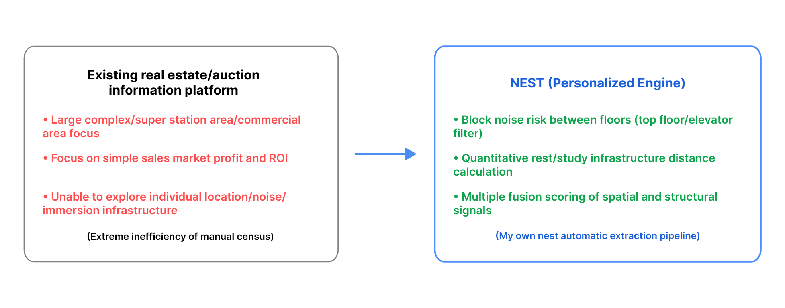
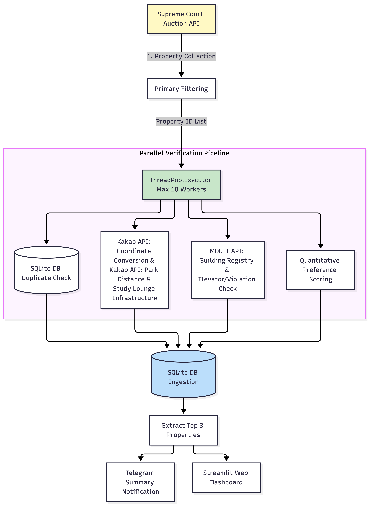

> **"From pain to cures"** <br />
> *All genuine engineering begins with the burning desire to solve a problem encountered in life.*<br /> This article is a development log born from the daily agony of "inter-floor noise ringing every night."

## 1. Background & Problem Definition: Finding a Sanctuary from Pain

### 1.1. Sleepless Nights and the Desperate Need for a Quiet Space
The irregular footsteps and vibrations late at night from the upper floor where a shift worker resided completely collapsed my daily rhythm. For me, a 'home' must be a space to empty accumulated daily stimuli and achieve deep rest. Thus, persistent sleep deprivation was a critical threshold threatening both health and productivity.

Buying a home free from noise in Seoul immediately was financially constrained. Therefore, I turned my eyes to the court auction market, where real-residence properties could be acquired at 10-20% lower than market value within a limited budget.

### 1.2. Universal Market Value vs. Personalized Lifestyle Preferences
Existing real estate platforms only provide mainstream indicators like 'Return on Investment (ROI)', 'ultra-subway proximity', and 'large complex price margins'. However, my criteria for an ideal home were explicit:

* **Inter-Floor Noise Blockage:** Preference for top floors without upper-floor noise sources, equipped with an elevator for convenience.
* **Neighborhood Infrastructure for Immersion:** Quiet residential areas over commercial districts, parks within a 500m(0.3mi) radius, and dense clusters of libraries/coworking spaces/study lounges.
* **Risk Exclusion:** Exclusion of nightlife noise zones, unauthorized buildings, and excessively failed auction lots.

Reviewing hundreds or thousands of auction properties manually every day on court and map apps has clear limits. Hence, I engineered **NEST (Niche Estate Screening Tool)**, an automated pipeline that synthesizes complex data sources (Court Auctions, Kakao Geospatial API, MOLIT/Ministry of Land Infrastructure and Transport) to screen listings matching my exact criteria.

> *In other words, just as birds do not build nests anywhere, NEST serves as an automated pipeline precisely screening **'my own nest where I truly want to dwell'**.*

 

## 2. System Architecture & Technical Trade-offs

> **"Analyzing thousands of auction listings in minutes: Multi-API orchestration and concurrency optimization"**

To discover properties matching my residential preferences in real-time from the vast pool of court auctions across Seoul, I designed several core technical approaches.

### 2.1. System Architecture
NEST operates as a multi-threaded pipeline that integrates with 3 external APIs to collect and refine data before persisting it into SQLite.



### 2.2. Quantitative Preference Scoring Formula (out of 100)
Everyone’s definition of a "good home" differs. My preference criteria for healing and immersion mentioned in section 1.2 are modeled into the following quantitative scoring equation:

$$
\text{Final Score} = \text{Base Score}(50) + S_{\text{park}} + S_{\text{study}} + S_{\text{elevator}} + S_{\text{top\_floor}}
$$

* **Base Score (50 pts):** Awarded upon passing primary filters (no illegal construction, no harmful nightlife establishments nearby).
* **Park Proximity ($S_{\text{park}}$):** Up to 20 points proportional to park accessibility within a 500m radius.
* **Infrastructure ($S_{\text{study}}$):** 2 points per study cafe or coworking space within a 1km radius (up to 15 pts).
* **Bonuses ($S_{\text{elevator}}, S_{\text{top\_floor}}$):** +5 points each for elevator presence and top-floor conditions.

### 2.3. Core Toy Code Implementations

#### ① Supreme Court Session Synchronization
The Supreme Court auction search server returns empty results if searched directly without session setup. A preprocessing step is essential to send a POST request with proper headers to register specific court codes within the session.

```python
import requests


def sync_court_session(session: requests.Session, court_code: str):
    url = "https://www.courtauction.go.kr/pgj/pgjsearch/selectCortOfcDeptLst.on"
    headers = {
        "Content-Type": "application/json;charset=UTF-8",
        "Referer": "https://www.courtauction.go.kr/pgj/index.on",
    }
    try:
        session.post(
            url,
            json={"dma_srchGdsDtlSrchInfo": {"cortOfcCd": court_code}},
            headers=headers,
            timeout=5,
        )
    except Exception as e:
        print(f"Session Sync Warning: {e}")
```

#### ② Kakao & Ministry of Land API Orchestration
After cleaning and standardizing the address, the Kakao API analyzes the location context, and the Ministry of Land's Building Registry Open API is queried to verify illegal alterations and elevator availability.

```python
import requests
import re


def verify_property(address: str, kakao_key: str):
    clean_addr = re.sub(r".*?구|해당층.*|\d+동|\d+호", "", address).strip()
    headers = {"Authorization": f"KakaoAK {kakao_key}"}

    res = requests.get(
        "https://dapi.kakao.com/v2/local/search/address.json",
        headers=headers,
        params={"query": clean_addr},
        timeout=3,
    ).json()
    if not res.get("documents"):
        return None

    doc = res["documents"][0]
    park_res = requests.get(
        "https://dapi.kakao.com/v2/local/search/keyword.json",
        headers=headers,
        params={"query": "공원", "x": doc["x"], "y": doc["y"], "radius": 500},
        timeout=3,
    ).json()
    min_park_dist = (
        min([float(p["distance"]) for p in park_res.get("documents", [])])
        if park_res.get("documents")
        else 999.0
    )

    return {"min_park_dist": min_park_dist, "has_elevator": True, "is_violation": False}
```

#### ③ Idempotency Management via SQLite
Re-evaluating the exact same auction property by calling external APIs every single time places heavy load on the system and risks hitting rate limits. SQLite DB is utilized to guarantee idempotency.

```python
import sqlite3


def is_already_processed(auction_id: str) -> bool:
    conn = sqlite3.connect("nest_vault.db", timeout=30)
    cursor = conn.cursor()
    cursor.execute(
        "CREATE TABLE IF NOT EXISTS processed_auctions (id TEXT PRIMARY KEY, score REAL)"
    )
    cursor.execute("SELECT 1 FROM processed_auctions WHERE id = ?", (auction_id,))
    exists = cursor.fetchone() is not None
    conn.close()
    return exists
```

#### ④ ThreadPoolExecutor for 10x Concurrency Boost
Sequential processing suffered 10–15 minutes of I/O bottlenecks per batch. Applying `ThreadPoolExecutor(max_workers=10)` reduced total execution time down to roughly 1 minute (a 10x improvement).

```python
from concurrent.futures import ThreadPoolExecutor


def process_single(prop: dict):
    if is_already_processed(prop["id"]):
        return None
    return {"id": prop["id"], "score": 85.5}


def evaluate_auctions_fast(raw_properties: list, max_workers: int = 10):
    with ThreadPoolExecutor(max_workers=max_workers) as executor:
        results = list(executor.map(process_single, raw_properties))
    return sorted([r for r in results if r], key=lambda x: x["score"], reverse=True)
```

### 2.4. Technical Trade-offs
* **Multiprocessing vs. ThreadPoolExecutor**
  * **Decision:** Adopted `ThreadPoolExecutor`.
  * **Rationale:** The performance bottleneck lies in external REST API response waiting times (I/O Bound), not CPU computation complexity. Rather than multiprocessing which incurs heavy process creation overhead, thread-based execution sharing memory and light context-switching was optimal.
* **Real-time API Call vs. DB Caching (SQLite)**
  * **Decision:** Applied a DB-first caching strategy.
  * **Rationale:** To comply with daily API rate limits and maximize execution speed, evaluated auction case numbers are semi-permanently cached in local SQLite to block redundant external re-queries at the root.

## 3. Development & Debugging Archive: Breaking Through 5 Key Bottlenecks

1. **[Bottleneck 1] Integration of Fragmented Real Estate Data:** Overcame the lack of a single unified open API by organically combining public open data with commercial spatial APIs.
2. **[Bottleneck 2] The Quagmire of the Supreme Court Auction Homepage:** Bypassed crawling directly from the main home page—cluttered with unnecessary DOM elements such as popups, security auth layers, and frame structures. By engineering a direct entry structure straight to the target list pages, initial crawl entry speed and stability were secured.
3. **[Bottleneck 3] The Wall of SPAs (Single Page Applications):** Even when changing search filters or courts on screen, the browser URL remained identical while communicating asynchronously (AJAX) behind the scenes. Background XHR/Fetch requests were successfully tracked and captured using Chrome DevTools (F12).
4. **[Bottleneck 4] Security Hygiene:** Isolated sensitive information (API keys, Telegram bot tokens, local DB files) using `.gitignore` and managed them safely via `python-dotenv`.
5. **[Bottleneck 5] Cloud Deployment Discrepancy:** Created a `.streamlit/config.toml` configuration file to maintain UI theme and font rendering consistency between the local development environment and Streamlit Cloud deployment.


## 4. Lessons Learned & Connection to the 'From pain to cures' Motto

> *"Many great cures and solutions sprout from the profound pain one has experienced firsthand."*

My personal life motto, **"From pain to cures"**, is a guiding principle forged to transform physical pain—so severe it forced me to pause my career—into a vocation of Chapter 2: **developing solutions for others enduring the same suffering**.

NEST is both a tool to build a forward operating base for deep focus to realize that mission, and a project where the development process itself operated under that exact motto.<br /> 

The spatial distress caused by relentless nighttime inter-floor noise was successfully converted into a powerful development drive: 'I will find my own sanctuary with my own hands, leveraging my expertise as a data scientist.'

The practical lesson learned while developing NEST was that **'the highest score is not always the right answer.'** Even after strictly applying preliminary filtering rules, some properties that scored highest numerically (Top 1–3) turned out to involve tangled legal rights issues upon closer title analysis. Instead, high-quality, clean properties were densely clustered in the top tier scoring 90 points and above.

Through this experience, I realized that an algorithm is not an absolute judge that decides everything, but rather functions best as a **Decision Support System** that reduces search costs for someone equipped with domain knowledge.

A life where I heal more people's pain through technology and science using the very tools that healed me in the sanctuary I secure through NEST—that is the next chapter of my life.

---
*Related source codes and detailed implementations are available in <ins>[GitHub Repository](https://github.com/min-kim/life-hacks/tree/main/NEST)</ins>. Additionally, you can test the application directly in your browser via the <ins>[Live Demo Application](https://nest-auction.streamlit.app/)</ins>.*